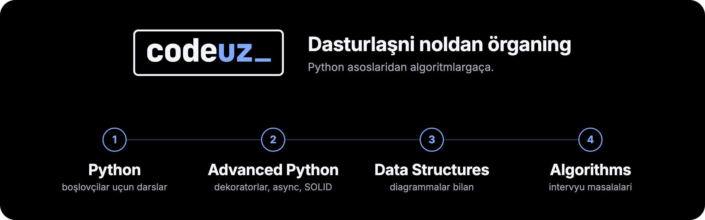

  

Dasturlaşni noldan örganing: Python Foundationsdan algoritmlargaça.

Hamma darsliklar bepul va brauzerda işlaydi: qisqa darsni öqing, kodni şu sahifaning özida işga tuşiring va maşqlaringizni özingiz tekşiring.

### Darsliklar

Darsliklar şu tartibda: har biri oldingisiga tayanadi.

| | Darslik | Nimani örganasiz | Hajmi | Til |
|:-:|---|---|---|---|
| 1 | **[Python Foundations](https://codeuz-edu.github.io/python-tutorials/uz/)** | Python noldan | 73 dars, 6 loyiha | özbekça, inglizça |
| 2 | **[Advanced Python](https://codeuz-edu.github.io/python-advanced/uz/)** | Python vositalari qanday işlaşi va SOLID tamoyillari | 13 dars, 1 loyiha | özbekça, inglizça |
| 3 | **[Maʼlumot tuzilmalari va algoritmlar](https://codeuz-edu.github.io/data-structures-and-algorithms/uz/)** | Maʼlumot tuzilmalari va algoritmlar, rasmlar va Python misollari bilan | 29 dars | özbekça, inglizça |
| 4 | **[Algorithms Roadmap](https://codeuz-edu.github.io/algorithms-roadmap/)** | Mavzular böyiça intervyu masalalari | 137 masala, 16 mavzu | inglizça |

### Qayerdan boşlaş

| Agar siz | Şundan boşlang |
|---|---|
| dasturlaşni endi boşlayotgan bölsangiz | 1. Python Foundations |
| Pythonda kod yoza olsangiz | 2. Advanced Python |
| intervyuga tayyorlanayotgan bölsangiz | 3. Maʼlumot tuzilmalari va algoritmlar, keyin 4. Algorithms Roadmap |

### Video darslar

Dasturlaş böyiça özbek tilidagi videolar [YouTubeʼdagi codeuz kanalida](https://youtube.com/@codeuz).

### Hissa qöşiş

Xato yoki tuşunarsiz joy topsangiz, tegişli repozitoriyda issue oçing. Batafsil: [hissa qöşiş qöllanmasi](https://github.com/codeuz-edu/.github/blob/main/CONTRIBUTING.md) (ingliz tilida).
